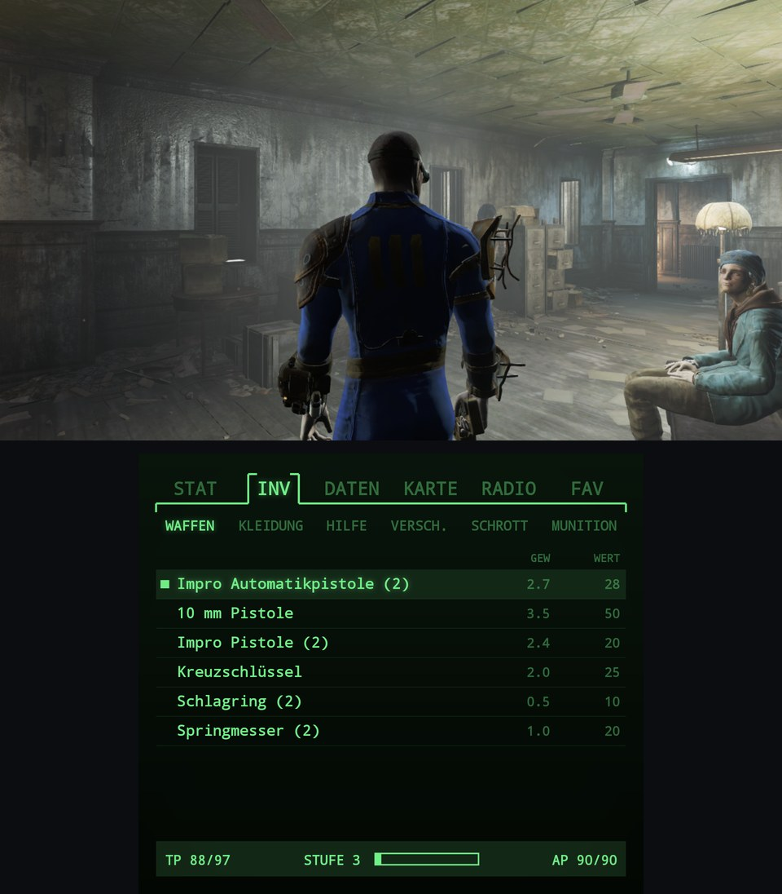
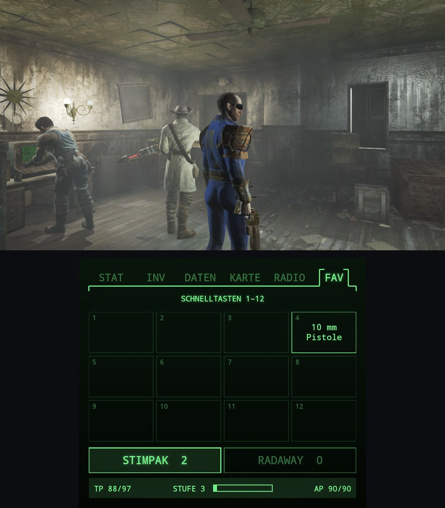
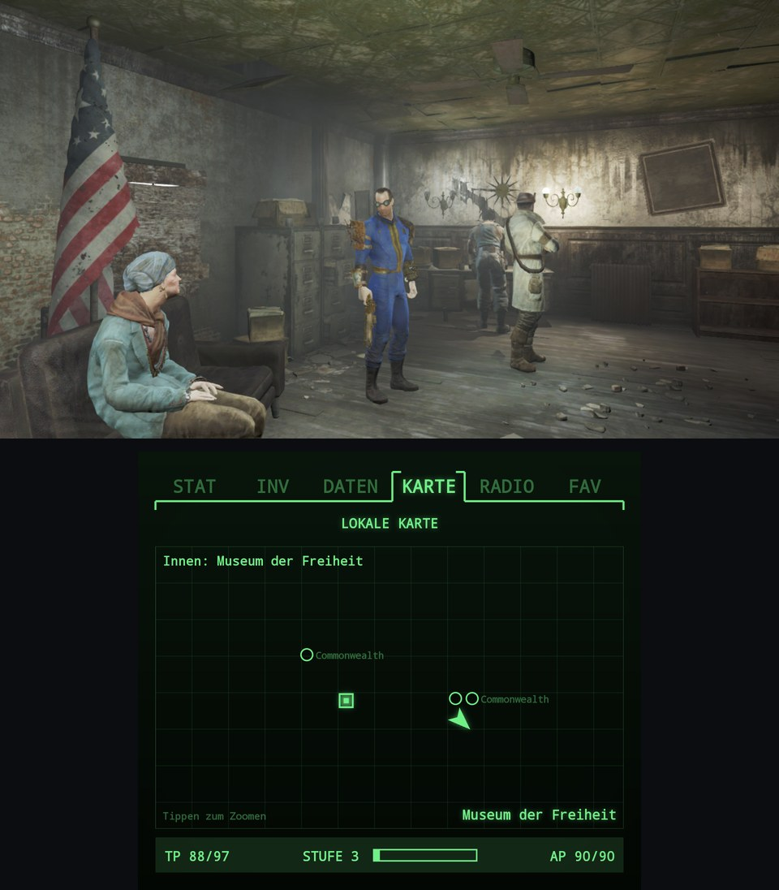

# Thor Pip-Boy

A second-screen **Pip-Boy for Fallout 4** on the dual-screen **AYN Thor** handheld: the game runs on
the top screen (Steam via [DroidDeck](https://github.com/Droid-Deck/DroidDeck)), a green phosphor Pip-Boy with live game data
runs on the bottom screen. Tap an item to equip or use it.

It replaces the official Pip-Boy companion app interface, which no longer works in the current
Fallout 4 release (1.11.240).

> **Not affiliated with Bethesda Softworks, ZeniMax Media or Microsoft.** Fallout and Pip-Boy are
> trademarks of their respective owners. This is an unofficial fan project; it contains no game files
> and no Bethesda artwork – all graphics are drawn by the app itself.

<!-- Video: add links here, e.g. [▶ Demo on YouTube](https://youtu.be/XXXX) -->

| Inventory (top + bottom screen) | Favourites 1–12, Stimpak, RadAway | Local map |
|---|---|---|
|  |  |  |

<sub>Real screenshots from an AYN Thor, Fallout 4 via DroidDeck on top, Thor Pip-Boy 0.2.0 below (Pip-Boy language follows the game language, German here).</sub>

**All Thor ports: [toravo.de/en/thor](https://toravo.de/en/thor/)**
**Videos:** _coming soon_

## What it shows

| Tab | Content |
|---|---|
| STAT | Status figure with limb condition, HP/AP/level/XP, rads, resistances; S.P.E.C.I.A.L. |
| INV | Weapons, apparel, aid, misc, junk, ammo with weight/value – **tap = equip / unequip / use** |
| DATA | Quests with objectives (active quest first); world info: date, location, caps, weight |
| MAP | World map markers + quest markers + player arrow; local map indoors (doors, quest marker) |
| RADIO | Stations in range, radio on/off |
| FAV | Quick keys 1–12 (your in-game favorites) as big tiles – **tap = equip / use**; Stimpak and RadAway buttons with count |

English and German UI, auto-reconnect, “waiting for Fallout 4…” screen.

## Quick start

You need: Fallout 4 on Steam (runtime **1.11.240**), running on the AYN Thor through [DroidDeck](https://github.com/Droid-Deck/DroidDeck).

1. **Download from [Releases](../../releases):** `ThorPipBoy.apk` and `ThorPipBoy.dll` (+ optional `ThorPipBoy.ini`).
2. **Install the runtime dependencies yourself** (they may not be redistributed):
   - [F4SE 0.7.9](https://www.nexusmods.com/fallout4/mods/42147?tab=files) (Fallout 4 Script Extender, build for runtime 1.11.240; official site: [f4se.silverlock.org](https://f4se.silverlock.org/))
   - [Address Library for F4SE Plugins](https://www.nexusmods.com/fallout4/mods/47327?tab=files) – the file containing `version-1-11-240-0.bin`
3. **Copy into the Fallout 4 folder** (`…/steamapps/common/Fallout 4/`, on the Thor under
   `Android/data/com.droiddeck.launcher/files/steam/steamapps/common/Fallout 4/`):
   ```
   f4se_loader.exe, f4se_1_11_240.dll        (from F4SE)
   Data/Scripts/*                            (from F4SE)
   Data/F4SE/Plugins/version-1-11-240-0.bin  (Address Library)
   Data/F4SE/Plugins/ThorPipBoy.dll          (this project)
   Data/F4SE/Plugins/ThorPipBoy.ini          (optional)
   ```
   With adb you can use [`plugin/tools/install_thor.sh`](plugin/tools/install_thor.sh).
4. **Steam launch option** (Fallout 4 → ⚙ → Properties → General → Launch options), so Steam starts F4SE:
   ```
   bash -c 'a=("${@/Fallout4Launcher.exe/f4se_loader.exe}"); exec "${a[@]/Fallout4.exe/f4se_loader.exe}"' -- %command%
   ```
5. **Install the app:** `adb install ThorPipBoy.apk` (or open the APK on the device).
   For the auto-reopen guard (see below) grant once:
   ```
   adb shell appops set de.harmssi.thorpipboy SYSTEM_ALERT_WINDOW allow
   adb shell appops set de.harmssi.thorpipboy SCHEDULE_EXACT_ALARM allow
   ```
6. **Start “Thor Pip-Boy”** from the launcher: it opens the Pip-Boy on the bottom screen and starts
   Fallout 4 via DroidDeck on the top screen. Load a save – the Pip-Boy fills with live data.

If it works for you, a ⭐ on GitHub helps – and [subscribing on YouTube](https://www.youtube.com/@toravomusic?sub_confirmation=1) helps me bring more ports to the Thor.

### Notes

- Fallout 4 uses almost all RAM on the Thor. While a save loads, Android may close the Pip-Boy;
  the built-in guard reopens it ~20 s after the game is stable again. It never reopens it during
  loading, because bringing an app to the front lowers DroidDeck's priority and could get the game killed.
- The plugin only listens on `127.0.0.1:8767` (configurable in `ThorPipBoy.ini`).
- Saves are never written by the plugin.

## Repository layout

| Folder | What | License |
|---|---|---|
| [`plugin/`](plugin/) | F4SE plugin `ThorPipBoy.dll` (C++23, CommonLibF4), WebSocket server, cross-built on Linux with clang-cl + xwin | GPL-3.0-or-later with the CommonLibF4 modding/linking exceptions |
| [`app/`](app/) | Android app `de.harmssi.thorpipboy` (Java, no dependencies) | MIT |

## Legal

- **Own code:** `plugin/` is GPL-3.0-or-later (with the same Modding Exception and GPL-3.0 Linking
  Exception as CommonLibF4, see [`plugin/EXCEPTIONS`](plugin/EXCEPTIONS)), because the DLL statically links
  [CommonLibF4](https://github.com/libxse/commonlibf4) (GPL-3.0-or-later with those exceptions). `app/` is MIT; it only talks
  to the plugin over a local WebSocket and links no GPL code.
- **Third-party code in the DLL:** CommonLibF4 (GPL-3.0-or-later + exceptions, git submodule),
  [spdlog](https://github.com/gabime/spdlog) (MIT, git submodule), the Microsoft C/C++ runtime (statically linked via the MSVC toolchain).
- **Not included and not redistributed:** F4SE (its readme forbids redistribution; it also requires
  plugins to publish their source – this repository does), the Address Library (Nexus Mods, runtime only),
  any game files.
- **Trademarks:** Fallout, Pip-Boy and Bethesda are trademarks of ZeniMax Media Inc. / Bethesda Softworks;
  used only to describe compatibility. No affiliation or endorsement.

## Building

See [`plugin/README.md`](plugin/README.md) and [`app/README.md`](app/README.md).
